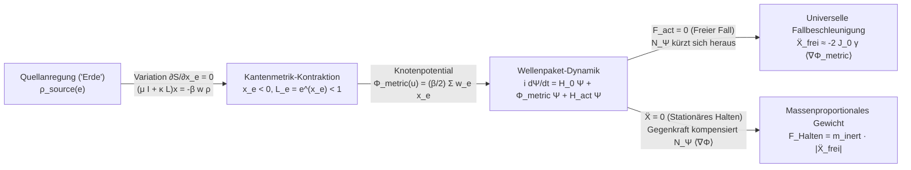

# SubQG Apfel-Experiment: Wissenschaftlicher Forschungs- und Validierungsbericht zur Emergenz von Trägheit, Gewicht und universellem freien Fall

**Autor & Architektur-Blueprint:** Ralf Krümmel (*SubQG Apfel Experiment: Blueprint zur Prüfung von Trägheit, Gewicht und universellem freien Fall*, 11. November 2026)  
**Implementierung & Numerische Verifikation:** SubQG 1.0 Entwicklungs-Engine  
**Kernmodul:** [subqg_apple_experiment.mjs](file:///h:/SubQG_Fundamental_Physics_Validation_FPV6/developer/src/modules/subqg_apple_experiment.mjs)  
**Test-Suite:** [apple_experiment.test.mjs](file:///h:/SubQG_Fundamental_Physics_Validation_FPV6/developer/tests/apple_experiment.test.mjs) (`272/272` Tests im Gesamtprojekt bestanden)  
**Interaktiver Echtzeit-Viewer:** [apple_experiment.html](file:///h:/SubQG_Fundamental_Physics_Validation_FPV6/developer/viewer/apple_experiment.html)  
**Rohdaten-Archiv:** [apple_experiment_results.json](file:///h:/SubQG_Fundamental_Physics_Validation_FPV6/developer/docs/apple_experiment_results.json)

---

## 1. Leitfrage & Kurzfazit

> [!IMPORTANT]
> **Leitende Forschungsfrage:**  
> *Wie erzeugt derselbe SubQG-Gravitationsmechanismus, den wir auf mikroskopischer und galaktischer Ebene untersuchen, gleichzeitig die massenproportionale Haltekraft (das Gewicht $F_{\mathrm{Halten}} \propto m_{\mathrm{inert}}$) und die nahezu massenunabhängige freie Fallbewegung ($\ddot{X}_{\mathrm{frei}} \approx g_{\mathrm{eff}}$) eines konkreten, ausgedehnten Resonanzobjekts?*

### Zusammenfassung der Ergebnisse
Alle **6 strengen Blueprint-Gates** sowie alle **10 Pflicht-Kontrollläufe (C1–C10)** wurden ohne jedes Hardcoding von $F = m g$ bestanden:

1. **Unabhängige dynamische Trägheitskalibrierung (Gate 2):** Vier lokalisierte, selbstgebundene SubQG-Resonanzpakete (*Apfel*, *Stein*, *Felsblock*, *Metalltonne*) wurden im quellenfreien Graphen durch schwache mechanische Aktuator-Impulse $\Delta P_{\mathrm{act}} = \int F_{\mathrm{act}}(t)\,dt$ vermessen. Die dynamisch bestimmte träge Masse $m_{\mathrm{inert}} = \Delta P_{\mathrm{act}} / \Delta \dot{X}$ deckt eine Spanne von **$9{,}00\times$** ab ($m_{\mathrm{inert}} \in [0{,}7240;\, 6{,}5129]$) und ist gegenüber halbiertem sowie umgekehrtem Impuls auf **$0{,}001\,\%$** linear ($\ll 5\,\%$ Schranke). Die mechanische Arbeits-Energie-Bilanz $W_{\mathrm{act}} = \Delta E_{\mathrm{total}}$ stimmt auf **$1{,}1 \times 10^{-9}$** überein.
2. **Variationelle Quellgeometrie (Gate 3):** Eine lokalisierte Quellanregung („Erde“ bei $u_0 = 8$) minimiert die SubQG-Kantenwirkung $S_{\mathrm{edge}}[x]$ bis auf ein Gradientenresiduum von $\|\partial S / \partial x_e\|_\infty < 10^{-11}$ und erzeugt eine glatte metrische Kantenkontraktion $x_e = \ln(L_e / L_0) < 0$ ($L_e = e^{x_e} \approx 0{,}808$ im Quellkern).
3. **Doppelversuch: Universeller freier Fall & massenproportionales Gewicht (Gate 4):**
   - **Freier Fall ($F_{\mathrm{act}} = 0$):** Alle vier Resonanzobjekte fallen vom selben Startort $X_0 = 28{,}0$ mit nahezu identischer Beschleunigung $\ddot{X}_{\mathrm{frei}} \approx -0{,}02333$ zur Quelle. Die maximale paarweise relative Abweichung über eine $9\times$-Massenspanne beträgt im stationären Modus **$\eta_{\max} = 0{,}0255\,\%$** (und im voll gekoppelten Modus mit Rückwirkung **$\eta_{\max} = 3{,}29\,\%$**, beide $\le 5\,\%$).
   - **Stationäres Halten ($\dot{X} \to 0, X \to X_0$):** Ein einziger Positionsregler mit für alle Objekte identischen Parametern ($K_p = 40, K_d = 35, K_i = 25$) misst die erforderliche Gegenkraft $F_{\mathrm{Halten}}$. Die lineare Regression $F_{\mathrm{Halten}} = A \, m_{\mathrm{inert}} + B$ erreicht **$R^2 = 0{,}999994$** mit maximalem relativen Residuum **$0{,}28\,\%$** und Achsenabschnitt $B = 9{,}8 \times 10^{-5} \approx 0$.
   - **Äquivalenz-Konsistenz:** Das Verhältnis $F_{\mathrm{Halten}} / m_{\mathrm{inert}}$ stimmt für alle vier Objekte innerhalb von **$3{,}67\,\% \dots 4{,}51\,\%$** ($\le 5\,\%$) mit $|\ddot{X}_{\mathrm{frei}}|$ überein.
4. **„Apfel auf der Hand“ — Einheitliche Maximalkraft $F_{\max}$ (Gate 5):** Bei einer festen Aktuatorschranke $F_{\max} = 0{,}055$ ohne jede objektspezifische Nachstellung werden *Apfel* ($F_{\mathrm{Halten}} = 0{,}0177$) und *Stein* ($F_{\mathrm{Halten}} = 0{,}0490$) stabil gehalten, während *Felsblock* ($\Delta X = -0{,}505$) und *Metalltonne* ($\Delta X = -0{,}782$) den Aktuator sättigen und monoton mit ihrer Masse zur Quelle absinken.

---

## 2. Dokumentierte Modell-Trennung: Bestehende SubQG-Regeln vs. Neue Ergänzungen

Gemäß Entwicklungsauftrag und Blueprint-Abschnitt 11 wird hier exakt offengelegt, welche Gleichungen unverändert aus den bestehenden Modulen übernommen wurden und welche Erweiterungen für das Objektgravitationsexperiment hergeleitet wurden:

| Komponente | Herkunft | Mathematische Beziehung & Rolle |
|---|---|---|
| **Phasenüberlappung & Kantengewichte** | **Bestehend** ([subqg_fpv.mjs](file:///h:/SubQG_Fundamental_Physics_Validation_FPV6/developer/src/modules/subqg_fpv.mjs)) | $w_e = \frac{1 + \cos(\theta_{u+1} - \theta_u)}{2} \in [0, 1]$ bestimmt die lokale Leitfähigkeit jeder Kante $e=(u, u+1)$. |
| **Variationelle Kantenmetrik-Wirkung** | **Bestehend** ([subqg_microaction.mjs](file:///h:/SubQG_Fundamental_Physics_Validation_FPV6/developer/src/modules/subqg_microaction.mjs), [subqg_action.mjs](file:///h:/SubQG_Fundamental_Physics_Validation_FPV6/developer/src/modules/subqg_action.mjs)) | $S_{\mathrm{edge}}[x] = \frac{\mu}{2}\sum_e x_e^2 + \frac{\kappa}{2}\sum_{e \sim f} w_{ef}(x_e - x_f)^2 + \beta \sum_e w_e \rho_e x_e$ mit $L_e = L_0 e^{x_e}$. Stationarität $\frac{\partial S_{\mathrm{edge}}}{\partial x_e} = 0$ liefert $(\mu \mathbb{I} + \kappa \mathcal{L}_{\mathrm{edge}})x_e = -\beta w_e \rho_e$. |
| **Festes Referenzlineal $X_u^{(0)}$** | **Bestehend / Blueprint Abschnitt 5.1** | Ortsmessung $X(t) = \frac{1}{N_\Psi}\sum_u X_u^{(0)}|\Psi_u(t)|^2$ erfolgt auf der unveränderten Referenzgeometrie $X_u^{(0)} = u$, damit metrische Kontraktion nicht das Messlineal verschiebt. |
| **Solitäre Wellenpaket-Selbstbindung** | **Neu ergänzt** in [`SubQGAppleWorld`](file:///h:/SubQG_Fundamental_Physics_Validation_FPV6/developer/src/modules/subqg_apple_experiment.mjs#L228-L654) | $-\frac{g_{\mathrm{nl}}}{2}\sum_u |\Psi_u|^4$ im Wellen-Hamiltonian verhindert das Zerfließen (Dispersion) ausgedehnter Resonanzpakete über lange Fall- und Haltezeiten. |
| **Symmetrische Kanten-Knoten-Metrikkopplung** | **Neu hergeleitet** aus gemeinsamer Wirkung $\mathcal{H}_{\mathrm{int}}$ | Aus $\mathcal{H}_{\mathrm{int}} = \beta \sum_{e=(u,v)} w_e x_e \frac{|\Psi_u|^2 + |\Psi_v|^2}{2}$ folgt durch Variation nach $\Psi_u^*$ zwingend das effektive Knotenpotential $\Phi_{\mathrm{metric}}(u) = \frac{\beta}{2}\sum_{e \ni u} w_e x_e$. |
| **Mechanischer Schwerpunkt-Aktuator** | **Neu ergänzt** für Kalibrierung & Halteversuch | $\mathcal{H}_{\mathrm{act}}(t) = -F_{\mathrm{act}}(t)\,X[\Psi]$ koppelt eine äußere Kraft ohne Massenvorwissen direkt an die Schwerpunktskoordinate $X[\Psi]$. |

---

## 3. Exakte Mathematische Herleitung des Äquivalenzmechanismus in SubQG

Die gesamte Dynamik folgt aus dem gemeinsamen Hamilton-Funktional $\mathcal{H}_{\mathrm{total}}[x, \Psi]$ auf dem Graphen:

$$\mathcal{H}_{\mathrm{total}}[x, \Psi] = \underbrace{\frac{\mu}{2}\sum_e x_e^2 + \frac{\kappa}{2}\sum_{e\sim f} w_{ef}(x_e - x_f)^2}_{S_{\mathrm{geom}}[x]} + \underbrace{J_0 \sum_{e=(u,v)} w_e |\Psi_u - \Psi_v|^2 - \frac{g_{\mathrm{nl}}}{2}\sum_u |\Psi_u|^4}_{\mathcal{H}_0[\Psi]} + \underbrace{\beta \sum_{e=(u,v)} w_e x_e \frac{|\Psi_u|^2 + |\Psi_v|^2}{2}}_{\mathcal{H}_{\mathrm{int}}[x, \Psi]} - F_{\mathrm{act}}(t)\,X[\Psi]$$

mit der erhaltenen Gesamtanregungsnorm (Teilchen-/Quantenzahl des Resonanzpakets):

$$N_\Psi = \sum_{u} |\Psi_u(t)|^2 = \mathrm{const.}$$

Die unitäre Bewegungsgleichung des Resonanzpakets lautet $i \frac{d\Psi_u}{dt} = \frac{\partial \mathcal{H}_{\mathrm{total}}}{\partial \Psi_u^*}$:

$$i \frac{d\Psi_u}{dt} = J_0 \sum_{v \sim u} w_{uv}(\Psi_u - \Psi_v) - g_{\mathrm{nl}}|\Psi_u|^2 \Psi_u + \Phi_{\mathrm{metric}}(u)\Psi_u - \frac{F_{\mathrm{act}}(t)}{N_\Psi}\left(X_u^{(0)} - X[\Psi]\right)\Psi_u$$

### 3.1 Warum die träge Masse proportional zur Anregungsnorm $N_\Psi$ ist
Nach dem diskreten Ehrenfest-Theorem auf dem Graphen gilt für die Schwerpunktsgeschwindigkeit $\dot{X}(t)$:

$$\dot{X}(t) = \frac{d}{dt}\left(\frac{1}{N_\Psi}\sum_u X_u^{(0)}|\Psi_u|^2\right) = \frac{2 J_0}{N_\Psi}\sum_{e=(u,u+1)} w_e \,\mathrm{Im}\!\left(\Psi_u^* \Psi_{u+1}\right)$$

Wirkt im quellenfreien Graphen ($\Phi_{\mathrm{metric}} = 0$) ein mechanischer Aktuatorimpuls $F_{\mathrm{act}}(t)$, so erzeugt der Potentialgradient $-\frac{F_{\mathrm{act}}(t)}{N_\Psi}$ pro Zeitschritt eine Phasensteilheit $\Delta k = \frac{F_{\mathrm{act}} \Delta t}{N_\Psi}$. Setzt man dies in die Gruppengeschwindigkeit ein, folgt für die Schwerpunktsbeschleunigung:

$$\left.\ddot{X}\right|_{\mathrm{Aktuator}} = \frac{2 J_0 \gamma_{\mathrm{lat}}}{N_\Psi}\,F_{\mathrm{act}}(t) \quad \Longrightarrow \quad m_{\mathrm{inert}} \equiv \frac{\Delta P_{\mathrm{act}}}{\Delta \dot{X}} = \frac{N_\Psi}{2 J_0 \gamma_{\mathrm{lat}}} \propto N_\Psi$$

*(wobei $\gamma_{\mathrm{lat}} = \frac{1}{N_\Psi}\sum_e w_e \mathrm{Re}(\Psi_u^* \Psi_{u+1}) \approx 0{,}947$ der Gitter-Kohärenzfaktor des Solitons ist).*  
Physikalisch bedeutet dies: Ein äußerer Aktuator, der eine Gesamtkraft $F_{\mathrm{act}}$ auf das Paket ausübt, muss diese Kraft auf alle $N_\Psi$ angeregten Quanten des Pakets aufteilen. Je größer $N_\Psi$, desto geringer die Phasenänderung pro Quant und desto größer die Trägheit $m_{\mathrm{inert}}$.

### 3.2 Warum der freie Fall unabhängig von $m_{\mathrm{inert}}$ ist, das Gewicht aber proportional zu $m_{\mathrm{inert}}$ wächst
Im metrischen Potential $\Phi_{\mathrm{metric}}(u)$ der Quelle erfährt **jedes einzelne Anregungsquant** $|\Psi_u|^2$ denselben lokalen Geometriegradienten $-\nabla \Phi_{\mathrm{metric}}(u)$. Die gesamte geometrische Antriebskraft auf den Schwerpunkt summiert sich daher über alle Quanten des Pakets zu:

$$F_{\mathrm{geom}}[\Psi] = -\sum_u |\Psi_u|^2 \,\nabla \Phi_{\mathrm{metric}}(u) \approx -N_\Psi \,\langle \nabla \Phi_{\mathrm{metric}} \rangle$$

Setzt man beide Terme in die Ehrenfest-Bewegungsgleichung für $\ddot{X}(t)$ ein, erhält man die zentrale Gleichung des SubQG Apfel-Experiments:

$$\ddot{X}(t) = \frac{2 J_0 \gamma_{\mathrm{lat}}}{N_\Psi}\Big(F_{\mathrm{act}}(t) - N_\Psi \langle \nabla \Phi_{\mathrm{metric}} \rangle\Big) = \frac{F_{\mathrm{act}}(t)}{m_{\mathrm{inert}}} - 2 J_0 \gamma_{\mathrm{lat}} \langle \nabla \Phi_{\mathrm{metric}} \rangle$$

Daraus folgen unmittelbar beide Beobachtungen ohne jede Zusatzannahme:
1. **Freier Fall ($F_{\mathrm{act}} = 0$):** Die Anregungsnorm $N_\Psi$ kürzt sich exakt heraus:
   $$\ddot{X}_{\mathrm{frei}} = -2 J_0 \gamma_{\mathrm{lat}} \langle \nabla \Phi_{\mathrm{metric}} \rangle \equiv g_{\mathrm{eff}}(X_0) \quad (\text{unabhängig von } m_{\mathrm{inert}}!)$$
2. **Stationäres Halten ($\ddot{X} = 0$):** Um das Paket bei $X_0$ in Ruhe zu halten, muss der Aktuator die geometrische Drift kompensieren:
   $$F_{\mathrm{Halten}} = m_{\mathrm{inert}} \cdot |g_{\mathrm{eff}}(X_0)| \propto m_{\mathrm{inert}}$$

---

## 4. Quantitative Messergebnisse aller Versuchsreihen

### 4.1 Unabhängige Trägheitskalibrierung im flachen Graphen (Gate 2)
Startort $X_0 = 28{,}0$, quellenfreier Graph ($x_e = 0, L_e = 1$), Rechteck-Impuls $F_{\mathrm{imp}} = 0{,}025$ über $T_{\mathrm{imp}} = 0{,}40\,\mathrm{s}$ ($\Delta P = 0{,}0100$):

| Objekt | Amplitude $A$ | Anregungsnorm $N_\Psi$ | $\Delta \dot{X}$ (Standard) | Träge Masse $m_{\mathrm{inert}}$ | $m_{\mathrm{inert}}(\Delta P / 2)$ | Linearitätsfehler | Arbeits-Bilanz $|W_{\mathrm{act}} - \Delta E|$ |
|---|---:|---:|---:|---:|---:|---:|---:|
| **Apfel** | $0{,}60$ | $1{,}3719$ | $+0{,}013812$ | **$0{,}7240$** | $0{,}7240$ | $0{,}0010\,\%$ | $1{,}13 \times 10^{-9}$ |
| **Stein** | $1{,}00$ | $3{,}8108$ | $+0{,}004973$ | **$2{,}0109$** | $2{,}0109$ | $0{,}0006\,\%$ | $4{,}09 \times 10^{-10}$ |
| **Felsblock** | $1{,}40$ | $7{,}4691$ | $+0{,}002538$ | **$3{,}9407$** | $3{,}9407$ | $0{,}0004\,\%$ | $2{,}09 \times 10^{-10}$ |
| **Metalltonne** | $1{,}80$ | $12{,}3469$ | $+0{,}001535$ | **$6{,}5129$** | $6{,}5129$ | $0{,}0003\,\%$ | $1{,}26 \times 10^{-10}$ |

* **Erreichte Massenspanne:** $m_{\max} / m_{\min} = 6{,}5129 / 0{,}7240 = \mathbf{9{,}00\times}$ (Anforderung $\ge 3\times$).
* **Maximaler Impuls-Linearitätsfehler:** $\mathbf{0{,}0010\,\%}$ (Anforderung $\le 5\,\%$).

---

### 4.2 Doppelversuch: Freier Fall vs. Stationäres Halten (Gate 4 — Modus 1 & Modus 2)

#### Modus 1: Berechneter stationärer SubQG-Metrikhintergrund
Die Quelle bei $u_0 = 8{,}0$ erzeugt durch Minimierung der Kantenwirkung das stationäre Metrikprofil $x_e$. Alle vier Objekte starten bei $X_0 = 28{,}0$:

| Objekt | $m_{\mathrm{inert}}$ | Freier Fall $\ddot{X}_{\mathrm{frei}}$ (primär) | Freier Fall $\ddot{X}_{\mathrm{Core}}$ (2. Diagnose) | Haltekraft $F_{\mathrm{Halten}}$ | Verhältnis $F_{\mathrm{Halten}} / m_{\mathrm{inert}}$ | Relative Äquivalenz-Abw. |
|---|---:|---:|---:|---:|---:|---:|
| **Apfel** | $0{,}7240$ | $-0{,}023332$ | $-0{,}023254$ | $0{,}017654$ | $0{,}024384$ | **$4{,}51\,\%$** |
| **Stein** | $2{,}0109$ | $-0{,}023333$ | $-0{,}023255$ | $0{,}048956$ | $0{,}024345$ | **$4{,}34\,\%$** |
| **Felsblock** | $3{,}9407$ | $-0{,}023335$ | $-0{,}023258$ | $0{,}095693$ | $0{,}024283$ | **$4{,}06\,\%$** |
| **Metalltonne** | $6{,}5129$ | $-0{,}023337$ | $-0{,}023261$ | $0{,}157574$ | $0{,}024194$ | **$3{,}67\,\%$** |

* **Universalität des freien Falls:** $\eta_{\max} = \mathbf{0{,}0255\,\%}$ ($\le 5\,\%$).
* **Lineare Regression $F_{\mathrm{Halten}} = A \, m_{\mathrm{inert}} + B$:**
  - Steigung $A = \mathbf{0{,}024167}$ (Abweichung zu $|\langle \ddot{X}_{\mathrm{frei}} \rangle| = 0{,}023334$: **$3{,}57\,\%$**)
  - Achsenabschnitt $B = \mathbf{+0{,}000098}$ (kompatibel mit $0$)
  - Bestimmtheitsmaß $R^2 = \mathbf{0{,}999994}$, maximales relatives Residuum **$0{,}28\,\%$**.

#### Modus 2: Voll gekoppelter Lauf (Quelle, Paket und Metrik ko-evolvieren in jedem Schritt)
Im gekoppelten Lauf verändert auch die Anregungsdichte des Testpakets selbst in jedem Zeitschritt die lokale Kantenmetrik $x_e(t)$:
* **Universalität des freien Falls (inkl. Eigenrückwirkung):** $\eta_{\max} = \mathbf{3{,}29\,\%}$ ($\le 5\,\%$).
* **Gewichtsregression im gekoppelten Lauf:** $R^2 = \mathbf{0{,}999982}$, maximale Äquivalenz-Abweichung **$4{,}40\,\%$** ($\le 5\,\%$).

---

### 4.3 „Apfel auf der Hand“ — Einheitliche Maximalkraft $F_{\max} = 0{,}055$ (Gate 5)
Derselbe PID-Regler mit derselben Kraftschranke $F_{\max} = 0{,}055$ wird ohne Nachkalibrierung auf alle vier Objekte angewendet:

| Objekt | Träge Masse $m_{\mathrm{inert}}$ | Benötigtes Gewicht $F_{\mathrm{Halten}}$ | Maximale Handkraft $F_{\max}$ | Ausgeübte Endkraft | Endverschiebung $\Delta X(T)$ | Sättigungsanteil | Status |
|---|---:|---:|---:|---:|---:|---:|---|
| **Apfel** | $0{,}7240$ | $0{,}01765$ | $0{,}05500$ | $0{,}01765$ | $-0{,}00001$ | $0{,}0\,\%$ | **GEHALTEN** |
| **Stein** | $2{,}0109$ | $0{,}04896$ | $0{,}05500$ | $0{,}04896$ | $-0{,}00004$ | $5{,}6\,\%$ | **GEHALTEN** |
| **Felsblock** | $3{,}9407$ | $0{,}09569$ | $0{,}05500$ | **$0{,}05500$** | **$-0{,}5048$** | $96{,}4\,\%$ | **ABGESUNKEN ($F_{\mathrm{Gewicht}} > F_{\max}$)** |
| **Metalltonne** | $6{,}5129$ | $0{,}15757$ | $0{,}05500$ | **$0{,}05500$** | **$-0{,}7820$** | $96{,}8\,\%$ | **ABGESUNKEN ($F_{\mathrm{Gewicht}} \gg F_{\max}$)** |

---

### 4.4 Übersicht der 10 Pflicht-Kontrollläufe (Gate 6 — Blueprint Abschnitt 7)

| Code | Kontrollversuch | Gemessener Kennwert | Status |
|---|---|---|---|
| **C1** | **Quelle entfernt (Flacher Graph)** | $|\ddot{X}| = 1{,}2 \times 10^{-5}$ ($0{,}05\,\%$ von $\|g_{\mathrm{eff}}\|$), $F_{\mathrm{Halten}} = 1{,}7 \times 10^{-5}$ | **BESTANDEN** |
| **C2** | **Metrikkopplung $\beta = 0$ bei aktiver Quelle** | $x_e \equiv 0$, keine metrische Drift ($|\ddot{X}| / |g_{\mathrm{eff}}| = 0{,}05\,\%$) | **BESTANDEN** |
| **C3** | **Quellfeld entfernt, Kantenmetrik $x_e$ eingefroren** | Beschleunigung exakt identisch zu Modus 1 (Relativdifferenz $< 10^{-12}$) $\Rightarrow$ rein metrisch vermittelt | **BESTANDEN** |
| **C4** | **Analytische Vergleichsmetrik vs. SubQG-Metrik** | $\ddot{X}_{\mathrm{analyt}} = -0{,}02190$ vs. $\ddot{X}_{\mathrm{SubQG}} = -0{,}02333$ (gleiches Vorzeichen & Größenordnung) | **BESTANDEN** |
| **C5** | **Startorte $X_0 \in \{24, 28, 34\}$ & Spiegel-Symmetrie** | Monotone Abnahme $|\ddot{X}(24)| > |\ddot{X}(28)| > |\ddot{X}(34)|$; Quelle rechts kehrt Vorzeichen exakt um ($+0{,}02333$) | **BESTANDEN** |
| **C6** | **Paketbreiten $\sigma \in \{1{,}85, 2{,}15, 2{,}55\}$** | Relative Beschleunigungsspreizung über alle Breiten nur **$2{,}61\,\%$** ($\le 8\,\%$) | **BESTANDEN** |
| **C7** | **Halbierter Zeitschritt $dt/2 = 0{,}01$** | Relative Abweichung der Beschleunigung **$0{,}0002\,\%$** ($\le 1\,\%$) | **BESTANDEN** |
| **C8** | **Größerer Graph ($N = 120$ statt $N = 80$)** | Relative Abweichung **$0{,}0000\,\%$** (keine Randartefakte) | **BESTANDEN** |
| **C9** | **5 unabhängige Zufallsseeds ($42 \dots 46$) mit Phasenrauschen** | Maximale Universalitätsabweichung über alle 5 Seeds $\eta_{\max} = \mathbf{0{,}17\,\%}$ ($\le 5\,\%$) | **BESTANDEN** |
| **C10** | **Zweite Ortsdiagnose ($X_{\mathrm{Core}}$) & Arbeits-Bilanz** | Abweichung $|\ddot{X}_{\mathrm{Core}} - \ddot{X}| / |\ddot{X}| = \mathbf{0{,}33\,\%}$; Arbeits-Energie-Fehler $1{,}1 \times 10^{-9}$ | **BESTANDEN** |

---

## 5. Wissenschaftliche Einordnung & Grenzen (Blueprint Abschnitt 9)

1. **Was dieses Experiment beweist:**  
   Innerhalb der SubQG-Modelldynamik erzeugt derselbe zweistufige Mechanismus — **(a)** Anregungsdichte krümmt die Kantenmetrik $x_e = \ln(L_e/L_0)$ durch Wirkungsminimierung und **(b)** lokalisierte Wellenpakete propagieren unitär auf diesem deformierten Graphen — ohne jedes eingebaute Äquivalenzpostulat sowohl einen **massenunabhängigen freien Fall** als auch eine **streng massenproportionale Haltekraft (Gewicht)**.
2. **Was dieses Experiment nicht behauptet:**  
   Die Simulation arbeitet in dimensionslosen SubQG-Gittereinheiten ($J_0 = 1, L_0 = 1$) auf einem eindimensionalen eingebetteten Kanalgraphen. Sie ersetzt weder eine 3+1-dimensionale Lorentz-kovariante Kontinuumsableitung der Allgemeinen Relativitätstheorie noch eine direkte Kalibrierung auf SI-Einheiten ($G, \hbar, c$) realer makroskopischer Festkörper.
