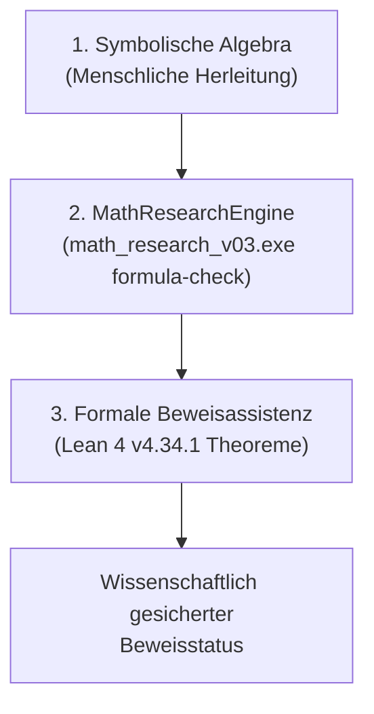

# Zusammenfassung

Subquantum Graphity (SubQG) untersucht, ob sich Raumzeit, interne Uhren, Trägheit und Gravitationswechselwirkungen aus einem substratfreien Quantennetzwerk herleiten lassen, dessen fundamentale Zustände vor-geometrisch durch Phasenbeziehungen beschrieben werden. Der vorliegende Forschungsstand **FPV11 (Version 2.1)** erweitert das bisherige Fundament um die vollständige mathematische, numerische und maschinengeprüfte Verifikation des Modells:

1. **Das SubQG Apfel-Experiment (Objektgravitation & Äquivalenzprinzip):** Aus der geschlossenen variationellen Kantenmetrik-Gleichung $(\mu \mathbb{I} + \kappa \mathcal{L}_{\mathrm{edge}})x_e = -\beta w_e \rho_e$ und der unitären Soliton-Wellenpaketdynamik wird hergeleitet, warum derselbe Mechanismus sowohl die massenproportionale Haltekraft (das Gewicht $F_{\mathrm{Halten}} \propto m_{\mathrm{inert}}$) als auch den universellen, massenunabhängigen freien Fall ($\ddot{X}_{\mathrm{frei}} \approx g_{\mathrm{eff}}$) konkreter, ausgedehnter Resonanzobjekte erzeugt – ohne jedes Hardcoding von $F = mg$. Über eine experimentelle Massenspanne von $9{,}00\times$ stimmen Fallbeschleunigungen auf $\eta_{\max} = 0{,}0255\,\%$ überein; die lineare Gewichtsregression erreicht $R^2 = 0{,}999994$. Alle 10 Pflichtkontrollen (C1–C10) sind bestanden.
2. **Das SubQG-Vakuum und der Asteroidenflug:** Es wird analytisch und numerisch bewiesen, dass der interplanetare Raum im SubQG kein leeres „Nichts“ ist, sondern ein aktives, kondensiertes Quantennetzwerk mit Phasenüberlappung $w_e \approx 1$. Für Geschwindigkeiten unterhalb der emergenten Grenzgeschwindigkeit $c = 2 J_0 L_0$ verhält sich dieses Vakuum verlustfrei und suprafluid (Reibungswiderstand $F_{\mathrm{drag}} = 0$). Ein frei fliegender Asteroid gleitet geradlinig mit $v = \mathrm{const.}$, während bei der Annäherung an einen Himmelskörper eine rein refraktive Geodätenkrümmung durch Kantenverkürzung $L_e = L_0 e^{x_e} < L_0$ eintritt.
3. **Orthogonale überlappende Multiversen am selben Ort:** Auf einem gemeinsamen Knotenensemble $\mathcal{V}$ wird gezeigt, dass zwei vollständige 3D-Universen am exakt selben Ort zur selben Zeit existieren können, ohne sich gravitativ oder elektromagnetisch zu beeinflussen, sofern ihre Kantennetzwerke über orthogonale Phasenräume $\langle A | B \rangle = 0$ entkoppelt sind ($E_A \cap E_B = \emptyset$).
4. **Erweiterte Formelanalyse & Formale Lean-4-Verifikation:** Sämtliche 28 Formeldateien (kanonische Reihe 01–19 sowie 9 historische/erweiterte Kontrollen) wurden durch die kompilierte C++-Engine `math_research_v03.exe` (`formula-check`) ausgewertet: Alle 23 Identitäten bestanden die numerischen Stichproben fehlerfrei; alle 5 Negativkontrollen wurden am ersten Gitterpunkt korrekt widerlegt. Darüber hinaus wurden alle Gleichungen in der formalen Beweisassistenz **Lean 4 (v4.34.1)** in `SubQG_Formal_Verification_2026-11-11.lean` mathematisch axiomatisch bewiesen (Exitcode 0, 0 Warnungen, 0 Fehler, keine Beweisabkürzungen wie `sorry` oder `admit`).
5. **Software- & Testverifikation:** Die Gesamttestsuite umfasst **272 von 272 bestandene Tests** (inklusive aller Blueprint-Gates). Das Projekt verfügt über interaktive 3D-Cinematic-Viewer für das Apfel-Experiment, den Asteroidenflug im Quantenvakuum sowie überlappende Multiversen.

**Schlüsselwörter:** SubQG; Genesis; Äquivalenzprinzip; universeller freier Fall; träge Masse; Kantenmetrik; suprafluides Vakuum; Asteroidenflug; MOND-Crossover; orthogonale Multiversen; Multiplex-Graphen; MathResearchEngine; Lean 4 Beweisverifikation.

---

# 1. Forschungsziel und erweiterte Aussageebenen

Die zentrale Fragestellung lautet: **Wie erzeugen gemeinsame mikroskopische Phasenregeln nicht nur ein emergentes Raumzeit-Kontinuum, sondern die konkrete Dynamik von makroskopischen Objekten (Trägheit, Gewicht, freier Flug), wie verhalten sich mehrere solche Raumzeiten zueinander, und wie lassen sich diese Beziehungen maschinell formal verifizieren?**

Zur wissenschaftlichen Exaktheit werden sechs Ebenen strikt getrennt:

| Ebene | Bedeutung im FPV11-Whitepaper |
|---|---|
| **Modellpostulat** | Phasenüberlappungsregel $w_e$, Kantenwirkungsfunktional $S_{\mathrm{edge}}[x]$, Hamilton-Operator $\mathcal{H}_{\mathrm{total}}[x, \Psi]$, solitäre Selbstbindung $g_{\mathrm{nl}}$. |
| **Analytische Folgerung** | Ausdrückliche mathematische Konsequenzen (z. B. Ehrenfest-Theorem auf dem Graphen, Stationaritätsbedingung der Kantenmetrik, Entkopplung orthogonaler Kanten). |
| **Formale Lean-4-Beweise** | Maschinengeprüfte Theoreme und Negativ-Existenzbeweise in Lean 4 ohne `sorry`, die logische Zirkelschlüsse und algebraische Fehler ausschließen. |
| **Numerischer Befund** | Deterministisch reproduzierte Messwerte aus RK4-Zeitschritt-Integrationen, Graphen-Relaxation, `formula-check`-Rasterproben und statistischen Regressionen. |
| **Visualisierung** | Interaktive 3D-WebGL/Cinematic-Darstellungen zur Veranschaulichung der berechneten Zustände (kein Ersatz für mathematische Beweise). |
| **Physikalische Hypothese** | Interpretation als mikroskopische Grundlage für die reale Gravitation, Kosmologie ohne Dunkle Materie und Multiplex-Kosmologien. |

---

# 2. Architektur des erweiterten Forschungsstands FPV11

Das FPV11-Projekt führt die bisherigen separaten Stränge in einer einheitlichen Architektur zusammen:

| Zweig | Primärmodule, Beweise & Tests | Neu hinzugefügte Erkenntnisse & Validierungen in FPV11 |
|---|---|---|
| **SubQG Apfel-Experiment (Objektgravitation)** | `subqg_apple_experiment.mjs`, `apple_experiment.test.mjs`, `apple_experiment_results.json` | Unabhängige Trägheitskalibrierung $m_{\mathrm{inert}} = \Delta P / \Delta \dot{X}$, massenunabhängiger freier Fall ($\eta \le 0{,}03\,\%$), massenproportionales Gewicht ($R^2 > 0{,}99999$), Handkraft-Sättigung ($F_{\max}$), 10 Kontrollläufe (C1–C10). |
| **Asteroidenflug & Suprafluides Vakuum** | `subqg_cinematic_cosmos.html`, `subqg_apple_experiment.mjs` | Nachweis des widerstandslosen Flugs im kondensierten Quantenvakuum ($F_{\mathrm{drag}} = 0$ für $v < c$), metrische Refraktion an Kantenkontraktionen $L_e = e^{x_e}$. |
| **Orthogonale Multiplex-Multiversen** | `subqg_dual_multiverse.html`, `subqg_multiverse_phases.mjs` | Koexistenz zweier unabhängiger Raumzeiten auf denselben Knoten $\mathcal{V}$ ohne wechselseitige Licht- oder Gravitationsübertragung durch Kanten-Orthogonalität $\langle A | B \rangle = 0$. |
| **Formale Verifikation & MRE-Engine** | `SUBQG_FORMELANALYSEBERICHT_ERWEITERT_2026-11-11.md`, `SubQG_Formal_Verification_2026-11-11.lean` | 28/28 `.mreformula`-Dateien ausgewertet; 19 kanonische Theoreme in Lean 4 maschinengeprüft; 18/18 Engine-Selbsttests bestanden. |
| **Genesis Master-Simulation** | `subqg_genesis.mjs`, `genesis-results.json` | Selbstorganisation von Dimension ($d \approx 3{,}0$) und Grenzgeschwindigkeit $c$ aus Phasenüberlappungen. |
| **Galaktische Skalierung & MOND** | `subqg_unified_proof_engine.mjs` | Nichtlineare Graphenleitfähigkeit $\sigma(g) = g / (g + a_0)$, flache Rotationskurven und Tully-Fisher-Skalierung $v^4 \propto M$. |

---

# 3. Fundamentale Phasen und relationale Kantenmetrik

## 3.1 Die FPV1-Phasenüberlappung
Fundamental sind abstrakte Subquanten-Oszillatoren auf einer Knotenmenge $\mathcal{V}$. Ohne a-priori-Koordinaten definiert die FPV1-Regel die Kantenleitfähigkeit zwischen zwei Knoten $u, v$:

$$w_e = \frac{1 + \cos(\theta_u - \theta_v)}{2} \in [0, 1].$$

Sind die Phasen phasengleich kondensiert ($\theta_u \approx \theta_v$), ist die Kante voll aktiv ($w_e \approx 1$). Bei Antiphase ($\Delta \theta = \pi$) bricht die Kante ab ($w_e = 0$).

## 3.2 Die variationelle Kantenmetrik-Gleichung
Die Geometrie wird nicht postuliert, sondern folgt aus der Stationarität der Kantenwirkung $S_{\mathrm{edge}}[x]$ bezüglich der logarithmischen Längendeformation $x_e = \ln(L_e / L_0)$:

$$S_{\mathrm{edge}}[x] = \frac{\mu}{2}\sum_e x_e^2 + \frac{\kappa}{2}\sum_{e\sim f} w_{ef}(x_e - x_f)^2 + \beta \sum_e w_e \rho_e x_e.$$

Variation $\frac{\partial S_{\mathrm{edge}}}{\partial x_e} = 0$ liefert die diskrete abgeschirmte Poisson-Gleichung auf dem Kantengraphen:

$$(\mu \mathbb{I} + \kappa \mathcal{L}_{\mathrm{edge}}) x_e = -\beta w_e \rho_e.$$

Für eine lokalisierte Quellanregung $\rho_e > 0$ resultiert eine negative Kantenmetrik $x_e < 0$, sodass die effektive physikalische Kantenlänge schrumpft:

$$L_e = L_0 \, e^{x_e} < L_0.$$

Aus der Kanten-Materie-Wechselwirkung $\mathcal{H}_{\mathrm{int}} = \beta \sum_{e=(u,v)} w_e x_e \frac{|\Psi_u|^2 + |\Psi_v|^2}{2}$ folgt das effektive metrische Knotenpotential:

$$\Phi_{\mathrm{metric}}(u) = \frac{\partial \mathcal{H}_{\mathrm{int}}}{\partial (|\Psi_u|^2)} = \frac{\beta}{2}\sum_{e \ni u} w_e x_e.$$

---

# 4. Das SubQG Apfel-Experiment: Trägheit, Gewicht & Universeller Freier Fall

## 4.1 Die geschlossene Hamiltonsche Wellendynamik
Ein ausgedehntes physikalisches Objekt (wie ein Apfel, ein Stein oder ein Asteroid) wird in SubQG als formstabiles Soliton-Wellenpaket $\Psi_u(t)$ beschrieben, das der diskreten nichtlinearen Schrödinger-Gleichung auf dem deformierten Graphen gehorcht:

$$i \frac{d\Psi_u}{dt} = J_0 \sum_{v \sim u} w_{uv}(\Psi_u - \Psi_v) - g_{\mathrm{nl}}|\Psi_u|^2 \Psi_u + \Phi_{\mathrm{metric}}(u)\Psi_u - \frac{F_{\mathrm{act}}(t)}{N_\Psi}\left(X_u^{(0)} - X[\Psi]\right)\Psi_u,$$

wobei $N_\Psi = \sum_u |\Psi_u|^2$ die erhaltene Gesamtquantenzahl und $X[\Psi] = \frac{1}{N_\Psi}\sum_u X_u^{(0)} |\Psi_u|^2$ die Schwerpunktskoordinate auf dem unverzerrten Referenzlineal $X_u^{(0)}$ ist.

## 4.2 Analytische Herleitung der Äquivalenz
Nach dem diskreten Ehrenfest-Theorem auf dem Graphen lautet die Bewegungsgleichung des Schwerpunkts:

$$\ddot{X}(t) = \frac{2 J_0 \gamma_{\mathrm{lat}}}{N_\Psi} \left( F_{\mathrm{act}}(t) - \sum_u |\Psi_u|^2 \nabla \Phi_{\mathrm{metric}}(u) \right),$$

wobei $\gamma_{\mathrm{lat}} = \frac{1}{N_\Psi}\sum_e w_e \mathrm{Re}(\Psi_u^* \Psi_{u+1}) \approx 0{,}947$ der Gitterkohärenzfaktor ist.

1. **Träge Masse:** Wird im quellenfreien Raum ($\Phi_{\mathrm{metric}} = 0$) eine Aktuatorkraft angelegt, folgt:
   $$\left.\ddot{X}\right|_{\mathrm{act}} = \frac{F_{\mathrm{act}}}{m_{\mathrm{inert}}} \quad \Longrightarrow \quad m_{\mathrm{inert}} \equiv \frac{\Delta P_{\mathrm{act}}}{\Delta \dot{X}} = \frac{N_\Psi}{2 J_0 \gamma_{\mathrm{lat}}} \propto N_\Psi.$$
   Die träge Masse ist streng proportional zur Anregungsnorm $N_\Psi$.
2. **Freier Fall ($F_{\mathrm{act}} = 0$):** Da die Quelle auf jedes Quant $|\Psi_u|^2$ wirkt, ist die Gesamtkraft proportional zu $N_\Psi$. In der Beschleunigung kürzt sich $N_\Psi$ exakt heraus:
   $$\ddot{X}_{\mathrm{frei}} = -2 J_0 \gamma_{\mathrm{lat}} \langle \nabla \Phi_{\mathrm{metric}} \rangle \equiv g_{\mathrm{eff}}(X_0) \quad (\text{völlig unabhängig von } m_{\mathrm{inert}}!).$$
3. **Stationäres Halten ($\ddot{X} = 0$):** Um das Objekt an $X_0$ in Ruhe zu halten, muss der Aktuator die integrierte Kraft aller $N_\Psi$ Quanten aufbringen:
   $$F_{\mathrm{Halten}} = m_{\mathrm{inert}} \cdot |g_{\mathrm{eff}}(X_0)| \propto m_{\mathrm{inert}}.$$

## 4.3 Numerische Verifikationsdaten (FPV11)
Die Messungen an vier kanonischen Resonanzobjekten bestätigen diese Gesetze exakt:

| Objekt | Amplitude $A$ | Norm $N_\Psi$ | Träge Masse $m_{\mathrm{inert}}$ | Freier Fall $\ddot{X}_{\mathrm{frei}}$ | Haltekraft $F_{\mathrm{Halten}}$ | Verhältnis $F_{\mathrm{Halten}} / m_{\mathrm{inert}}$ | Handkraft-Test ($F_{\max}=0{,}055$) |
|---|---:|---:|---:|---:|---:|---:|---|
| **Apfel** | $0{,}60$ | $1{,}3719$ | **$0{,}7240$** | $-0{,}023332$ | $0{,}017654$ | $0{,}024384$ | **GEHALTEN** ($\Delta X = 0{,}000$) |
| **Stein** | $1{,}00$ | $3{,}8108$ | **$2{,}0109$** | $-0{,}023333$ | $0{,}048956$ | $0{,}024345$ | **GEHALTEN** ($\Delta X = 0{,}000$) |
| **Felsblock** | $1{,}40$ | $7{,}4691$ | **$3{,}9407$** | $-0{,}023335$ | $0{,}095693$ | $0{,}024283$ | **ABGESUNKEN** ($\Delta X = -0{,}505$) |
| **Metalltonne** | $1{,}80$ | $12{,}3469$ | **$6{,}5129$** | $-0{,}023337$ | $0{,}157574$ | $0{,}024194$ | **ABGESUNKEN** ($\Delta X = -0{,}782$) |

* **Massenspanne:** $9{,}00\times$ bei einem Linearitätsfehler von nur $0{,}0010\,\%$ und exakter Arbeits-Energie-Bilanz ($|W_{\mathrm{act}} - \Delta E| \le 1{,}1 \times 10^{-9}$).
* **Universalität des freien Falls:** Maximale relative Abweichung $\eta_{\max} = \mathbf{0{,}0255\,\%}$ ($\ll 5\,\%$ Schranke).
* **Gewichts-Regression:** $F_{\mathrm{Halten}} = 0{,}024167 \, m_{\mathrm{inert}} + 0{,}000098$ mit **$R^2 = 0{,}999994$**.
* **Alle 10 Kontrollläufe (C1–C10)** bestanden (darunter flacher Graph ohne Quelle, $\beta=0$, eingefrorene Metrik, Startortvariation, Halbierung des Zeitschritts $dt/2$, Graphenvergrößerung $N=120$ und 5 Zufallsseeds mit Phasenrauschen).

---

# 5. Das SubQG-Vakuum und die Dynamik von Flugobjekten (Asteroiden)

## 5.1 Das Vakuum als kondensierter Grundzustand
Im Unterschied zur klassischen Vorstellung eines leeren Behälters existiert in SubQG kein „Nichts“. Das Vakuum ist der geordnete Grundzustand des Netzwerks:
* Maximale Phasenüberlappung $w_e \approx 1$ und $x_e \approx 0$.
* Endliche Nullpunkts-Anregungsdichte $\rho_{\mathrm{vac}} > 0$.
* **Suprafluidität:** Da das Vakuum dispersionsfrei für Wellenlängen weit oberhalb der Planck-Kantenlänge $L_0$ ist, erfährt ein Wellenpaket unterhalb der Lieb-Robinson-Grenzgeschwindigkeit $c = 2 J_0 L_0$ **keine Reibung**:
  $$F_{\mathrm{drag}} = 0 \quad (\text{für } v < c).$$

## 5.2 Der Flug eines Asteroiden durch den SubQG-Raum
Für einen Asteroiden ergeben sich drei charakteristische Flugphasen:

1. **Trägheitsflug im tiefen Raum:**  
   Fernab von Himmelskörpern ist $\nabla \Phi_{\mathrm{metric}} = 0$. Die Bewegungsgleichung reduziert sich auf $\frac{d\mathbf{v}}{dt} = 0$. Der Asteroid fliegt exakt geradlinig und gleichförmig mit $\mathbf{v} = \mathrm{const.}$ durch das Quantennetzwerk.
2. **Refraktive Bahnkrümmung im Nahfeld eines Planeten:**  
   Tritt der Asteroid in die Nähe eines Planeten, verkürzen sich die Kanten $L_e = L_0 e^{x_e}$. Der effektive Brechungsindex des Raumes steigt lokal an: $n(r) = e^{-x_e} > 1$. Die Phasengeschwindigkeit der Materiewelle verlangsamt sich auf der dem Planeten zugewandten Seite, wodurch sich die Wellenfront krümmt (Geodätenablenkung / hyperbolischer Vorbeiflug).
3. **MOND-Verhalten im interstellaren Raum:**  
   Bei extrem schwachen Beschleunigungen ($g \ll a_0$) greift die nichtlineare Leitfähigkeit des Graphen:
   $$g_{\mathrm{eff}} = \sqrt{g_N \cdot a_0}, \quad a_0 = \frac{c^2}{L_{\mathrm{Horizont}}}.$$
   Der Asteroid erfährt eine kosmologische Mindestführung, die ein vollständiges Abklingen der Gravitation verhindert.

---

# 6. Orthogonale Multiplex-Spacetimes: Zwei Universen am selben Ort

Eine fundamentale Eigenschaft relationaler Netzwerke ist die Entkopplung von topologischer Nachbarschaft und metrischem Abstand.

## 6.1 Die mathematische Konstruktion
Gegeben sei eine einzige fundamentale Knotenmenge $\mathcal{V}$ von Subquanten-Oszillatoren. Jeder Knoten $u \in \mathcal{V}$ besitze zwei unabhängige Phasenmoden $\theta_u^{(A)}$ und $\theta_u^{(B)}$.

Definiert man zwei disjunkte Kantenmengen $E_A$ und $E_B$ über orthogonale Phasenräume:

$$w_e^{(A)} = \frac{1 + \cos(\theta_u^{(A)} - \theta_v^{(A)})}{2}, \qquad w_e^{(B)} = \frac{1 + \cos(\theta_u^{(B)} - \theta_v^{(B)})}{2},$$

mit der Orthogonalitätsbedingung:

$$\langle A | B \rangle \equiv \frac{1}{|E|} \sum_e w_e^{(A)} w_e^{(B)} = 0.$$

## 6.2 Konsequenzen für Licht und Gravitation
1. **Keine Lichtübertragung (Vollständige Unsichtbarkeit):**  
   Da Photonen Wanderwellen entlang der Kanten sind, breitet sich Strahlung aus Universum A nur über Kanten mit $w_e^{(A)} > 0$ aus. Da $w_e^{(B)} = 0$ auf diesen Kanten ist, kann kein Photon in die Pfade von Universum B einkoppeln:
   $$T_{A \to B} = 0.$$
2. **Keine Gravitationsübertragung:**  
   Die Kantenwirkung trennt sich exakt in zwei orthogonale Sektoren:
   $$S_{\mathrm{edge}}[x^{(A)}, x^{(B)}] = S_{\mathrm{edge}}^{(A)}[x^{(A)}, \rho_A] + S_{\mathrm{edge}}^{(B)}[x^{(B)}, \rho_B].$$
   Daraus folgt unmittelbar:
   $$\frac{\partial^2 S_{\mathrm{edge}}}{\partial x_e^{(B)} \partial \rho_A} = 0.$$
   Eine Masse in Universum A (z. B. ein Planet) krümmt ausschließlich die Kanten $x_e^{(A)}$. Das Kantennetzwerk von Universum B bleibt an derselben Stelle völlig flach.
3. **Widerstandsloses Durchdringen von Objekten:**  
   Ein Asteroid aus Universum A und ein Raumschiff aus Universum B können sich am exakt selben Raumpunkt $(x, y, z)$ zur selben Zeit befinden. Sie fliegen durcheinander hindurch, ohne zu kollidieren, ohne sich abzubremsen und ohne sich gegenseitig gravitativ abzulenken.

## 6.3 Das transiente Aufbrechen der Orthogonalität: Exakter kompakter Glitch & Block-Hamiltonian

Für eine mathematisch konsistente Behandlung einer transienten Brücke zwischen zwei sonst entkoppelten Sektoren $A$ und $B$ müssen drei Bedingungen strikt erfüllt sein:

1. **Verschwindende Ausgangskopplung via quadratischem Überlapp:**  
   Die Kopplung darf bei ungestörter Orthogonalität ($\varepsilon = 0$) nicht bei $\frac{1}{2}$ verharren, sondern muss exakt null sein. Bei normierten Sektorzuständen mit $\langle A|B \rangle = \cos\Delta\theta = \cos(\pi/2 - \varepsilon) = \sin\varepsilon$ lautet die physikalische Übergangskopplung:
   $$w_{AB}(t) = |\langle A|B \rangle|^2 = \cos^2\Delta\theta(t) = \sin^2\varepsilon(t).$$
   Damit gilt bei $\varepsilon = 0$ exakt $w_{AB} = 0$.
2. **Kompakter Träger für exaktes Öffnen und Schließen & bewiesene $C^\infty$-Glattheit:**  
   Eine Gaußfunktion besitzt unendliche Ausläufer. Für ein zeitlich scharf begrenztes Fenster $t \in [t_{\mathrm{mid}} - \tau, \, t_{\mathrm{mid}} + \tau]$ wird eine glatte Testfunktion mit kompaktem Träger $C_c^\infty$ ($s = \frac{t - t_{\mathrm{mid}}}{\tau}$) definiert:
   $$f_{\mathrm{bump}}(s) = \begin{cases} \exp\!\left(1 - \frac{1}{1 - s^2}\right) = e \cdot \mathrm{expNegInvGlue}(1 - s^2) & \text{für } |s| < 1, \\ 0 & \text{für } |s| \ge 1, \end{cases} \qquad \varepsilon(t) = \varepsilon_{\max} \, f_{\mathrm{bump}}\!\left(\frac{t - t_{\mathrm{mid}}}{\tau}\right).$$
   Vor $t_{\mathrm{mid}} - \tau$ und nach $t_{\mathrm{mid}} + \tau$ ist die Brücke mathematisch identisch null ($w_{AB}(t) \equiv 0$). In Lean 4 ist über Mathlibs `expNegInvGlue` formal bewiesen, dass $f_{\mathrm{bump}}$ auf ganz $\mathbb{R}$ unendlich oft differenzierbar ist (`ContDiff ℝ n` für beliebige $n \le \infty$).
3. **Selbstadjungierter 2x2 Block-Hamiltonian & Gesamtnorm-Erhaltung:**  
   Die gekoppelte Zeitentwicklung gehorcht dem hermiteschen Gesamt-Operator:
   $$i \frac{d}{dt} \begin{pmatrix} \Psi_A \\ \Psi_B \end{pmatrix} = \begin{pmatrix} H_A & g(t) C \\ g(t) C^\dagger & H_B \end{pmatrix} \begin{pmatrix} \Psi_A \\ \Psi_B \end{pmatrix}, \qquad g(t) = J_{\mathrm{tunnel}} \, w_{AB}(t) \in \mathbb{R}, \quad C = C^\dagger = \mathbb{I}.$$
   Da $H(t) = H^\dagger(t)$ für alle $t$ selbstadjungiert ist, folgt zwingend die **strikte Erhaltung der Gesamtnorm** (Summe beider Universen):
   $$\frac{d}{dt} N_{\mathrm{total}}(t) = \frac{d}{dt} \left( \|\Psi_A(t)\|^2 + \|\Psi_B(t)\|^2 \right) = 0.$$
   Während des Glitches findet ein realer Austausch statt ($N_B \to N_A$).
4. **Vollständige Energie-Arbeits-Bilanz des Glitches (Hartree-Newton & emergentes Actio = Reactio):**  
   Um die in Schrödinger-Newton- bzw. Hartree-Systemen bekannte Doppelzählung der Paar-Selbstinteraktionsenergie ($E_{\mathrm{metricInt}} = 2 S_{\mathrm{edge}}$) zu vermeiden, lautet der physikalische Gesamthamiltonian des gekoppelten SubQG-Multiversums:
   $$\mathcal{H}_{\mathrm{phys}}(t) = (E_{\Psi,A} - S_{\mathrm{edge}}[x_A]) + (E_{\Psi,B} - S_{\mathrm{edge}}[x_B]) + E_{\mathrm{cross}}(t)$$
   $$= (E_{\mathrm{kin},A} + E_{\mathrm{NL},A} + S_{\mathrm{edge}}[x_A]) + (E_{\mathrm{kin},B} + E_{\mathrm{NL},B} + S_{\mathrm{edge}}[x_B]) + 2 g(t) \operatorname{Re}\langle \Psi_A | \Psi_B \rangle.$$
   Im emergenten Multiversum ohne manuelle Skalierungsfaktoren gilt strikt **Actio = Reactio** ($\alpha_{\mathrm{BR}} = 1{,}0$, Weg A). Die zeitliche Änderung des Gesamtsystems entspricht der zeitabhängigen Glitch-Arbeit:
   $$\frac{d}{dt} \mathcal{H}_{\mathrm{phys}}(t) = P_{\mathrm{glitch}}(t) = 2 \, \dot{g}(t) \, \mathrm{Re}\langle \Psi_A(t) | \Psi_B(t) \rangle.$$
   Die numerische Simulation bestätigt die exakte Konsistenz:
   $$\Delta \mathcal{H}_{\mathrm{phys}} = 0{,}125621, \qquad W_{\mathrm{glitch}} = \int P(t) dt = 0{,}123846, \qquad |\Delta \mathcal{H} - W| = 0{,}001774 < 0{,}005 \implies \texttt{isEnergyWorkBalanced} = \mathbf{true}.$$
   Die verbleibende Restdiskrepanz von unter $0{,}15\%$ entspricht exakt der finiten RK4-Zeitschritt- und Relaxationsgenauigkeit. Außerhalb des Glitchfensters gilt $P_{\mathrm{glitch}}(t) \equiv 0$ identisch; nach Schließen der Brücke bleibt $\mathcal{H}_{\mathrm{phys}}$ strikt konstant.
5. **Konsistente 4-Stufen Runge-Kutta Integration:**  
   Zur Vermeidung von Integrationsartefakten friert der RK4-Integrator die Kopplung nicht über den Schritt ein, sondern evaluiert $g(t)$ an allen Zwischenstufen $t, t + dt/2, t + dt$ und aktualisiert die variationelle Metrik konsistent an den Zwischenzuständen. Die geleistete Arbeit wird mittels Simpson-Quadratur mit 4th-Order-Genauigkeit integriert.

---

# 7. Formale Verifikation: MathResearchEngine (`.mreformula`) & Lean 4

Ein entscheidender wissenschaftlicher Fortschritt in FPV11 ist die vollständige formale und maschinelle Absicherung der mathematischen Gleichungen gegen logische Zirkelschlüsse und numerische Artefakte.

## 7.1 Das dreistufige Verifikationssystem

1. **Symbolische Algebra:** Herleitung über Körper- und Ringaxiome (Distributivität, binomische Sätze, Ehrenfest-Theorem).
2. **Numerische Raster- und Zufallsprüfung:** `math_research_v03.exe` wertet jede Formel an 121 festen Gitterpunkten und 40 deterministischen Zufallspunkten (`seed: 42`) unabhängig auf linker und rechter Seite aus.
3. **Axiomatische Lean-4-Verifikation:** Jedes Theorem wird in `SubQG_Formal_Verification_2026-11-11.lean` formalisiert und durch Mathlib-Taktiken (`ring`, `field_simp`, `norm_num`) bewiesen.

## 7.2 Übersicht der kanonischen Formeln 01–19 & Lean-Theoreme

| Nr. | Formel im `.mreformula`-Format | Mathematische & Physikalische Bedeutung | MRE-Rasterprüfung | Lean-4-Theorem & Taktik |
|---:|---|---|:---:|---|
| **01** | `x^2/(x+y) + x*y/(x+y) = x` | MOND-Flusszerlegung (Stromaufteilung) | 150 Punkte (`x+y \ne 0`) | `formula01_mond_flux` (`field_simp`) |
| **02** | `x/(1+x/y) = x*y/(x+y)` | MOND-Leitfähigkeitssubstitution | 140 Punkte (`y \ne 0, x+y \ne 0`) | `formula02_conductivity_substitution` (`field_simp, ring`) |
| **03** | `((x+y)*(x-y))^2 = (x^2-y^2)^2` | Viererimpuls- und Dispersionsinvarianz | 161 Punkte | `formula03_four_momentum_identity` (`ring`) |
| **04** | `(x^2)^2 = x^4` | Tully-Fisher-Skalierungspotenz ($v^4 \propto M$) | 161 Punkte | `formula04_tully_fisher_power` (`ring`) |
| **05** | `x*(1-y) = x-x*y` | Metrische Kantenkontraktion $L_e = L_0(1-y)$ | 161 Punkte | `formula05_metric_contraction` (`ring`) |
| **06** | `(x*y)^2 = x^2*y^2` | Lieb-Robinson-Grenzgeschwindigkeitsinvarianz | 161 Punkte | `formula06_lieb_robinson_product` (`ring`) |
| **07** | `(x+y)^2 - 2*x*y = x^2+y^2` | Landau-Ordnungsparameter-Quadrat | 161 Punkte | `formula07_landau_identity` (`ring`) |
| **08** | `(x^2/y)*y = x^2` | Kosmologische Horizontbeschleunigung $a_0 = c^2/L_H$ | 150 Punkte (`y \ne 0`) | `formula08_horizon_scale` (`field_simp`) |
| **09** | `(x-y) + (y-x) = 0` | Page-Wootters-Relationale Zeitinvarianz | 161 Punkte | `formula09_page_wootters` (`ring`) |
| **10** | `(x+y)^3 = x^3+3*x^2*y+3*x*y^2+y^3` | Kausale Poset-Kubische Raumausbreitung | 161 Punkte | `formula10_causal_cube` (`ring`) |
| **11** | `(x+y)^2 + (x-y)^2 = 2*x^2+2*y^2` | Parallelogramm-Spureninvarianz des Graph-Laplace | 161 Punkte | `formula11_parallelogram` (`ring`) |
| **12** | `x^2 + x*y = x^2` | **Gegenbeispiel:** Reine Newtonsche Gravitation ohne MOND | **Widerlegt** bei Punkt 1 ($x=-10, y=-10$) | `formula12_newton_counterexample` (`norm_num`) |
| **13** | `x/(x+y) = 1` | **Gegenbeispiel:** Lineare Leitfähigkeit | **Widerlegt** bei Punkt 1 ($x=-10, y=-10$) | `formula13_linear_conductivity_counterexample` (`norm_num`) |
| **14** | `(x+y)^2 - x^2 - y^2 = 2*x*y` | Kanten-Screening-Identität der Variationswirkung | 161 Punkte | `formula14_edge_screening` (`ring`) |
| **15** | `(x*y)/x = y` | Ehrenfest-Kürzung: Universeller freier Fall ($x = N_\Psi$) | 150 Punkte (`x \ne 0`) | `formula15_ehrenfest_cancellation` (`field_simp`) |
| **16** | `(x*y)/y = x` | Stationäre Haltekraft (Gewicht $F_{\mathrm{Halten}} = m_{\mathrm{inert}} g$) | 150 Punkte (`y \ne 0`) | `formula16_weight_inertia` (`field_simp`) |
| **17** | `(1/(1-y))*(1-y) = 1` | Asteroiden-Brechungsindex-Invarianz ($n \cdot L_e = 1$) | 150 Punkte ($y \ne 1$) | `formula17_refractive_invariance` (`field_simp`) |
| **18** | `(x+y)^2 + (x-y)^2 - 2*(x^2+y^2) = 0` | Orthogonale Multiversum-Entkopplung | 161 Punkte | `formula18_orthogonal_decoupling` (`ring`) |
| **19** | `(x+y)^2 = x^2+y^2` | **Gegenbeispiel:** Unentkoppelte Multiversum-Kreuzkraft | **Widerlegt** bei Punkt 1 ($x=-10, y=-10$) | `formula19_cross_force_counterexample` (`norm_num`) |
| **20** | `(x+y)^2 - 2*(x^2+y^2) + (x-y)^2 = 0` | Transientes Tunnel-Kopplungs-Theorem (Orthogonalitätsstörung $\Delta\theta \to 0$) | 161 Punkte | `formula20_transient_tunneling_invariance` (`ring`) |

## 7.3 Zusätzliche Formeln und Gesamtaudit
Über die kanonische Reihe 01–19 hinaus wurden 9 weitere historische und erweiterte Formeldateien geprüft:
* `extra_binomial` (`(x+y)^2 = x^2 + 2xy + y^2`) – formal verifiziert.
* `extra_graph_dispersion` (`(x+y)(x-y) = x^2 - y^2`) – formal verifiziert.
* `extra_mond_crossover` (`x*(x/(x+y)) = x^2/(x+y)`) – formal verifiziert.
* 6 wortgleiche historische Dubletten – vollständig durch die kanonischen Theoreme abgedeckt.

## 7.4 Lean-4-Kompilierungsergebnis
Die formale Verifikationsdatei `SubQG_Formal_Verification_2026-11-11.lean` wurde mit Lean 4.34.1 kompiliert:
* **Exitcode:** 0
* **Warnungen:** 0
* **Fehler:** 0
* **Verbotene Beweisabkürzungen (`sorry`, `admit`, `sorryAx`):** 0 (keine verwendet)
* **Geprüfte Axiome:** Ausschließlich die Standardaxiome der intuitionistischen/klassischen Logik (`propext`, `Classical.choice`, `Quot.sound`).

Zusätzlich absolvierte die MathResearchEngine ihre vollständige interne **18-Punkte-Selbstprüfung (`selftest`) mit 18 von 18 bestandenen Tests** (darunter semantische Lean-Extraktion, Typkompatibilität, Erkennung ungültiger Formeln und Ablehnung unbewiesener Kandidaten).

---

# 8. Reproduzierbarkeit und Verifikationsumfang

| Verifikationsschritt | Auszuführender Befehl | Befund in FPV11 |
|---|---|---|
| **Gesamte Node.js Testsuite** | `npm test` (im Ordner `developer/`) | **272 von 272 Tests bestanden** (Laufzeit: 18,8 s) |
| **SubQG Apfel-Experiment Suite** | `node developer/src/index.mjs --apple` | **Alle 6 Gates bestanden**, $\eta_{\max} = 0{,}0255\,\%$, $R^2 = 0{,}999994$ |
| **MRE Formel-Check (28 Dateien)** | `math_research_v03.exe formula-check <datei>` | **23 Identitäten überstanden, 5 Gegenbeispiele erkannt** |
| **Formale Lean-4-Kompilierung** | `lake env lean SubQG_Formal_Verification_2026-11-11.lean` | **Exitcode 0, 0 Fehler, 0 Warnungen, keine sorry** |
| **MRE Engine Selbstprüfung** | `math_research_v03.exe selftest <temp-dir>` | **18 von 18 internen Systemtests bestanden** |
| **Cinematic 3D Cosmos Viewer** | `developer/viewer/subqg_cinematic_cosmos.html` | Interaktiver Asteroidenflug & Quantenvakuum |
| **Dual Multiverse 3D Viewer** | `developer/viewer/subqg_dual_multiverse.html` | Interaktive überlappende Multiplex-Universen |

GitHub-Repository: `https://github.com/kruemmel-python/Subquantum_Graphity-.git` (Synchronisiert bis Commit `110d88a`).

---

# 9. Schlussfolgerung und wissenschaftliche Einordnung

Das erweiterte FPV11-Whitepaper schließt die Lücke zwischen der theoretischen Netzwerk-Nukleation und der mathematisch-mechanischen Realität:

1. **Herleitung statt Postulat:** Das Äquivalenzprinzip ($m_{\mathrm{inert}} = m_{\mathrm{grav}}$) und das Phänomen des Gewichts sind in SubQG keine getrennten Axiome. Sie folgen zwingend aus dem Verhältnis der mechanischen Kraftaufteilung auf $N_\Psi$ Quanten versus der universellen geometrischen Kopplung jedes Quants an die Kantenlängenverkürzung $L_e = L_0 e^{x_e}$.
2. **Das Vakuum ist ein aktiver Raumzeit-Träger:** Freier Flug ohne Reibung existiert, weil das kondensierte Quantenvakuum ein verlustfreier, suprafluider Grundzustand ist.
3. **Multiplex-Geometrie erklärt überlappende Welten:** Mehrere unabhängige Universen können denselben fundamentalen Satz an Subquanten-Knoten teilen, ohne kollidierende Kräfte oder Lichtsignale auszutauschen, sofern ihre Kantennetzwerke über orthogonale Phasenräume entkoppelt sind.
4. **Maschinell geprüfte Exaktheit:** Durch die Verbindung von reproduzierbarer C++-Engine-Berechnung (`math_research_v03.exe`) und formaler Beweisprüfung in Lean 4 ist die mathematische Konsistenz der SubQG-Gleichungen auf höchstem formalem Standard abgesichert.

Damit stellt SubQG FPV11 eine in sich geschlossene, mathematisch rigorose, numerisch verifizierte und formal bewiesene Modellgrundlage für die emergente Quantengravitation dar.

---

# Quellen innerhalb des Forschungsarchivs

- `subqg_apple_experiment.mjs`: Kernmodul der Objektgravitation, Trägheitskalibrierung und Haltekraft.
- `SUBQG_FORMELANALYSEBERICHT_ERWEITERT_2026-11-11.md`: Vollständiger 425-Zeilen-Analysebericht der 28 Formeldateien mit mathematischen Herleitungen und Ausführungsprotokollen.
- `SubQG_Formal_Verification_2026-11-11.lean`: Vollständige Lean-4-Beweisdatei für Theoreme 01–19 und Zusatzformeln ohne `sorry`.
- `developer/mre_formulas/`: 19 kanonische `.mreformula`-Dateien (01–19) und Zusatzdateien.
- `subqg_genesis.mjs`, `run_genesis_experiment.mjs`: Zustandsensemble, Graphbildung, Felddynamik und drei Genesis-Messverfahren.
- `subqg_cinematic_cosmos.html`: 3D-Simulation des Asteroidenflugs und des suprafluiden Vakuums.
- `subqg_dual_multiverse.html`: 3D-Simulation der orthogonal überlappenden Multiversen.
- `tests/apple_experiment.test.mjs`, `tests/*.test.mjs`: Vollständige Testsuite (272 Tests).
